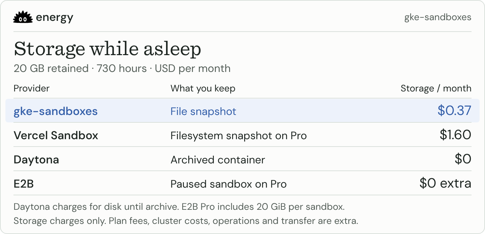
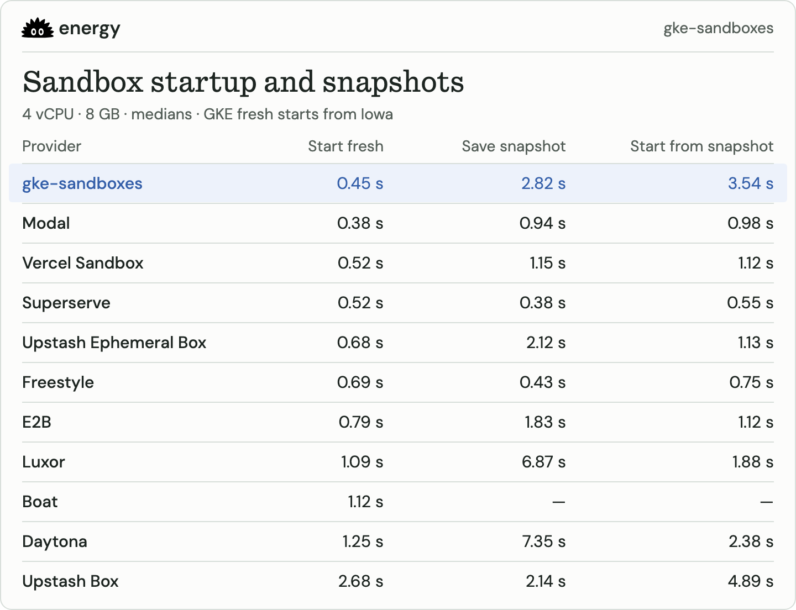

# How gke-sandboxes compares

Prices, speed and trade-offs against managed sandbox providers, with sources and the method behind each number. [Back to the README](../README.md)

## Running cost at 2 vCPU and 4 GB

For a sandbox that stays awake for **730 hours**, we estimate **$14.22** on GKE with every cluster cost included, or **1.9¢ for each hour awake**. Daytona and E2B each list **$120.89** for 2 vCPU and 4 GiB of compute, 16.6¢ an hour and about **8.5×** the GKE estimate. The README chart shows the hourly figures: each monthly figure below divided by 730. [Daytona pricing](https://www.daytona.io/pricing) · [E2B pricing](https://e2b.dev/pricing)

**Every row prices the same mostly idle sandbox.** On November 16 and 17, 2026, Energy’s running sandboxes averaged **0.076 vCPU and 0.73 GiB of memory** each, about 4% of 2 vCPU. That covers 381 sandbox-hours across 91 sandboxes, in 5-minute samples. Providers bill that sandbox differently. Daytona, E2B and Fly.io charge for the full size while it runs. Vercel charges for the CPU in use and all of the memory. Modal charges for what is used, down to a minimum reservation.

**The $14.22 GKE figure is a whole cluster bill divided by its sandboxes.** It is the [cost example](#estimate-your-sandbox-costs) in this repository: 520 sandboxes awake, 56 to a machine, on 12 machines including two spares. The machines and their disks cost $0.79 an hour each, $6,920 for the month. System nodes and the cluster fee add $373, and snapshot storage $100. The total of $7,393 comes to $14.22 per sandbox. A sandbox’s size limit does not change this figure, because machines are shared by what sandboxes use. The estimate needs that scale: a cluster with a handful of sandboxes still pays for its minimum machines.

**Fly.io costs $66.92.** A `performance-2x` Machine with 4 GB lists at $66.00 for 30 days in Fly’s lowest-priced regions, which is $66.92 for 730 hours. [Fly.io pricing](https://fly.io/docs/about/pricing/)

**Vercel Sandbox costs $69.01.** At Pro list rates in its default region (iad1), Vercel bills $0.128 per active CPU-hour and $0.0212 per GB-hour for memory. The CPU in use comes to $7.10. The 4 GB costs $61.90 over 730 hours, even when the code is waiting. Those hours span sessions because Pro allows up to 24 hours per session. [Vercel Sandbox pricing](https://vercel.com/docs/sandbox/pricing)

**Modal costs $25.75.** Modal bills a sandbox for the larger of its reservation and its use, at $0.00003942 per core-second and $0.00000667 per GiB-second. One Modal core is two vCPUs. The CPU in use is below the default reservation of 0.125 cores, which costs $12.95. The 0.73 GiB costs $12.80. A sandbox that reserved the full 2 vCPU and 4 GiB would cost $173.71. [Modal pricing](https://modal.com/pricing) · [Modal sandbox resources](https://modal.com/docs/guide/sandbox-resources)

**Packed tighter on C4D, the compute estimate is $7.80.** That figure is for `c4d-highmem-16` machines, about $709 a month each in Iowa, holding **128 sandboxes** apiece. It adds 40% for spare machines, node disks, system nodes, and the cluster fee. At the measured average, 128 sandboxes use about 10 of a machine’s 16 vCPUs and 93 GiB of the 116 GiB it has for pods. If your agents run hotter than this, fewer fit on a machine: at 0.24 vCPU each about 64 fit, and the estimate doubles to about $15.50. [Deploy that configuration](deploy.md#deploy-on-c4d)

The quickstart’s defaults are E2 machines holding about 64 sandboxes each, which comes to about **$12 per sandbox** by the C4D method. The managed providers’ figures exclude disks, plan fees, credits, and discounts. On GKE you operate the cluster yourself. On E2B this configuration requires a Pro plan, and the hours can span sessions.

## Storage for a 20 GB sleeping sandbox



For the same **20 billion bytes kept for 730 hours**, a GKE file snapshot in Iowa costs about **$0.37** (18.63 GiB in Cloud Storage Standard). GKE machines you keep running still appear on your cluster bill. [Google Cloud Storage pricing](https://cloud.google.com/storage/pricing)

**Vercel Sandbox charges $1.60 a month** to keep a 20 GB filesystem snapshot on Pro, at $0.08 per GB-month. For the full 730 hours, set retention to at least 31 days. The default is 30 days after last use. [Vercel Sandbox pricing](https://vercel.com/docs/sandbox/pricing) · [Snapshot retention](https://vercel.com/docs/sandbox/concepts/snapshots#snapshot-retention)

**Daytona charges $0 once a container is archived.** Its files can be restored when you start it again. If you leave it stopped instead, Daytona bills for reserved disk at $0.000108 per GiB-hour after the first 5 GiB. [Daytona billing](https://www.daytona.io/docs/billing) · [Daytona pricing](https://www.daytona.io/pricing)

**E2B charges $0 extra to keep this sandbox paused on Pro.** The $150 monthly plan includes 20 GiB of disk **per sandbox**. Its separate concurrency limit covers 100 running sandboxes, with paid options for more. Paused sandboxes can retain files and memory indefinitely. [E2B pricing](https://e2b.dev/pricing) · [E2B disk and concurrency limits](https://github.com/e2b-dev/e2b/blob/main/spec/openapi.yml) · [E2B pause and resume](https://docs.e2b.dev/sandbox/persistence)

## Build performance

We cloned, installed and built Better Auth in a sandbox with a 4 vCPU / 8 GB limit. **The build took 67 seconds.** Each row is one run on a C4D machine with one sandbox. The V8 row uses the benchmark’s current GitHub version. [GKE benchmark script](../examples/benchmark-build.sh)

| Metric | GKE on C4D |
| --- | ---: |
| Clone the repo | 1.6 s |
| Cold dependency install | 13.5 s |
| Build | 67 s |
| V8 web tooling throughput | 22.8 runs/s |

On the same machine packed with 95 other sandboxes, each using about 7% of a CPU as an idle agent sandbox does, the build took **81 seconds** and V8 throughput fell to **16.1 runs/s**. With four builds running at once among them, each took about **155 seconds**. The 67-second result is for a sandbox alone on its machine, and the $7.80 estimate is for a packed one. We have no head-to-head speed measurements for the managed providers. The quickstart’s default E2 machines are slower: the same build took 154 seconds alone on `e2-highmem-16`.

## Create, sleep, and wake times

Sandbox Bench tested ten managed sandbox configurations at **4 vCPU and 8 GB** from one server in Florida. Energy ran GKE separately at the same CPU and memory limits. Both start timers end when the first shell command (`true`) succeeds. The gke-sandboxes start time is from a VM in the cluster’s region with two sandboxes kept ready. All values are medians. [Benchmark](https://aisandboxbench.com/) · [Pinned results](https://github.com/opencoredev/sandbox-bench/blob/2b179ae31e90bb3f0ff7e50994e1fb2124818a93/src/data/benchmark.same-spec.json) · [Timer code](https://github.com/opencoredev/sandbox-sdk/blob/56e60d6f42a9b11efb487b5364efc325831e976a/bench/src/v2-runner.ts)



<details>
<summary>Read the timings as a table</summary>

| Provider | Start fresh | Save snapshot | Start from snapshot |
| --- | ---: | ---: | ---: |
| gke-sandboxes | 0.45 s | 2.82 s | 3.54 s |
| Modal | 0.38 s | 0.94 s | 0.98 s |
| Vercel Sandbox | 0.52 s | 1.15 s | 1.12 s |
| Superserve | 0.52 s | 0.38 s | 0.55 s |
| Upstash Ephemeral Box | 0.68 s | 2.12 s | 1.13 s |
| Freestyle | 0.69 s | 0.43 s | 0.75 s |
| E2B | 0.79 s | 1.83 s | 1.12 s |
| Luxor | 1.09 s | 6.87 s | 1.88 s |
| Boat | 1.12 s | — | — |
| Daytona | 1.25 s | 7.35 s | 2.38 s |
| Upstash Box | 2.68 s | 2.14 s | 4.89 s |

</details>

Saving a snapshot times the provider’s snapshot call. Starting from it creates a new sandbox and runs a command. The saved image and its size can differ by provider. Vercel also stops the source sandbox when it snapshots. Boat had no snapshot result. The benchmark excluded an earlier batch after Daytona snapshot timeouts. [Benchmark notes](https://aisandboxbench.com/) · [Published exclusions](https://github.com/opencoredev/sandbox-bench/blob/2b179ae31e90bb3f0ff7e50994e1fb2124818a93/src/data/benchmark.same-spec.json)

<details>
<summary>Pause and resume an existing sandbox</summary>

For providers the benchmark classified as preserving running processes, it also timed the pause and resume calls separately. These medians end when each call returns. The first command after resume was timed separately. [Stage timings](https://github.com/opencoredev/sandbox-bench/blob/2b179ae31e90bb3f0ff7e50994e1fb2124818a93/src/data/traces.same-spec.json) · [Run notes](https://github.com/opencoredev/sandbox-bench/blob/2b179ae31e90bb3f0ff7e50994e1fb2124818a93/src/data/benchmark.same-spec.json)

| Provider | Runs | Pause | Resume |
| --- | ---: | ---: | ---: |
| E2B | 100 | 1.30 s | 0.36 s |
| Freestyle | 100 | 0.32 s | 0.19 s |
| Luxor | 77 | 60.53 s | 2.13 s |
| Superserve | 100 | 0.40 s | 0.22 s |
| Upstash Box | 99 | 0.84 s | 0.33 s |

</details>

**How we measured GKE.** From a VM in Iowa, the first shell command finished in **447 ms** at the median and **1.41 s** at the 95th percentile. The previous code took 542 ms at the median and 883 ms at the 95th percentile on the same VM and cluster. Three of the four slowest starts on the updated SDK spent 0.83–1.25 s opening the command connection. We kept two sandboxes ready and alternated single starts and simultaneous pairs every six seconds. Each version handled 60 starts. Extra pod lookups fell from 60 to 0, and repeat claim attempts fell from 17 to 0. [All 120 starts](benchmarks/gke-warm-claim-2026-11-17.csv)

Without a ready sandbox, creating a sandbox took about 2.7 s. Saving a snapshot took 2.8 s, sleeping 4.0 s including removal of the pod, and waking 3.5 s. The sandbox held a small Vite app. Wake time grows with the number of files, as described under [operating limits](limits.md). The shared benchmark ran from Florida with its own images, so read the gke-sandboxes row as a neighbor, not a ranking. [Measurements](benchmarks) · [Benchmark code](../examples)

**Repeat the measurements.** Both benchmarks run against the quickstart cluster and take the verifier’s `--endpoint` and `--controller` arguments. On a Compute Engine VM, attach the controller service account with the `cloud-platform` and `userinfo.email` scopes and leave out `--controller`.

```sh
bun examples/benchmark-lifecycle.ts --endpoint "$ENDPOINT" --controller "$CONTROLLER"                       # create, save, sleep, wake
bun examples/benchmark-warm-pool.ts --endpoint "$ENDPOINT" --controller "$CONTROLLER" --profile --poolSize 2  # starts with two kept ready
```

**Keeping sandboxes ready.** A ready sandbox reserves its CPU and memory until a session claims it. Two were enough to serve bursts of two requests in our test. The quickstart creates sandboxes on demand. [Enable a warm pool](client.md#keep-sandboxes-ready-for-new-sessions)

## When to choose a managed provider

| If you need… | What to consider |
| --- | --- |
| A handful of sandboxes and no cluster to run | Daytona offers pay-as-you-go compute. With GKE, you manage capacity, upgrades, and recovery, and pay for machines between jobs. [Daytona](https://www.daytona.io/pricing) |
| A running process to pick up where it left off | E2B can preserve memory through sleep. This quickstart restores files. GKE supports whole-pod snapshots on compatible machines, but this client has only been verified with file restores. [GKE snapshot modes](https://docs.cloud.google.com/kubernetes-engine/docs/concepts/pod-snapshots) · [E2B](https://docs.e2b.dev/sandbox/persistence) |
| A preview URL to send to a user | Daytona ships expiring, revocable links. This setup keeps pods private and ships a small proxy as an example, with signed links that expire. It has no custom domains and no WebSockets. [Preview example](deploy.md#show-a-user-what-runs-in-a-sandbox) [Daytona previews](https://www.daytona.io/docs/en/preview/) |
| GPU access or a separate VM kernel per sandbox | The quickstart runs on CPUs with gVisor. Daytona offers GPU sandboxes. E2B gives each sandbox a Firecracker microVM. [Daytona GPUs](https://www.daytona.io/pricing) · [E2B isolation](https://e2b.dev/security) |

## Live verification

On November 17, 2026, we ran the lifecycle benchmark on GKE 1.36.4 in `us-central1` with gVisor on an `e2-highmem-16` node. Each of the 30 restores ran in a new pod and passed all six file checksums. The published sample excludes preliminary runs used to check the timing and storage counters. To repeat it, run the [quickstart’s](deploy.md) verifier command with `examples/benchmark-lifecycle.ts` in place of `examples/verify.ts`. The signed-in gcloud account needs permission to list objects in the snapshot bucket. [Timings and stored snapshot sizes](#create-sleep-and-wake-times)

## Estimate your sandbox costs

```sh
bun examples/cost.ts examples/cost-inputs.json
```

Edit the [example inputs](../examples/cost-inputs.json) to match your machine prices, sandboxes per machine, spare machines, and running hours. This example compares total cluster costs with a managed **2 vCPU / 4 GiB** sandbox at $0.1656/hour. It assumes a 500 GB node disk. The quickstart defaults to 150 GB, configurable with `TF_VAR_sandbox_node_disk_gb`. It is the source of the $14.22 figure above. For traffic that changes over the day, model the number of machines hour by hour.
